# Chronos-858D: Custom ESP32-S3 Hot Air Rework Station

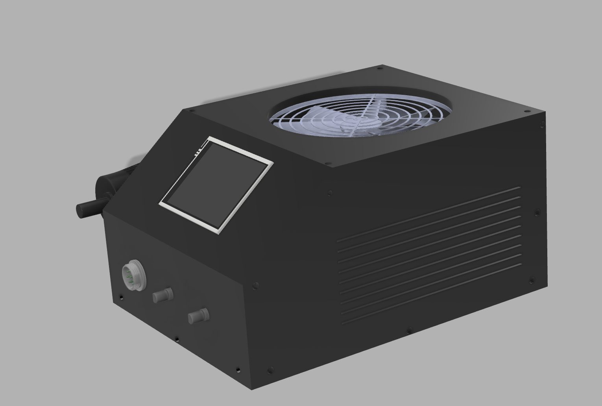
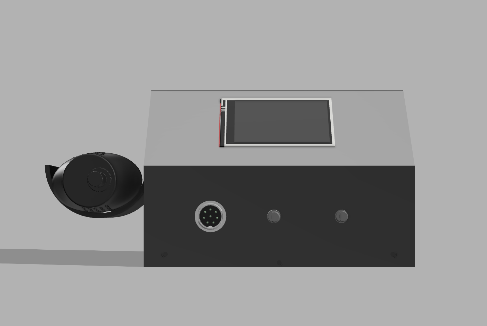
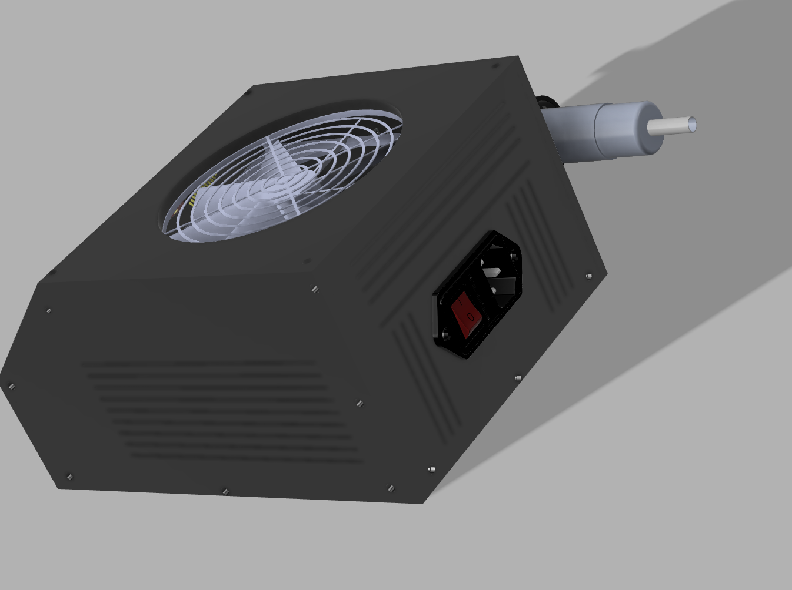
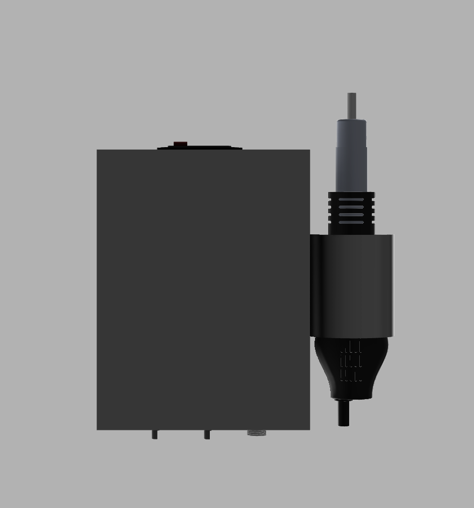
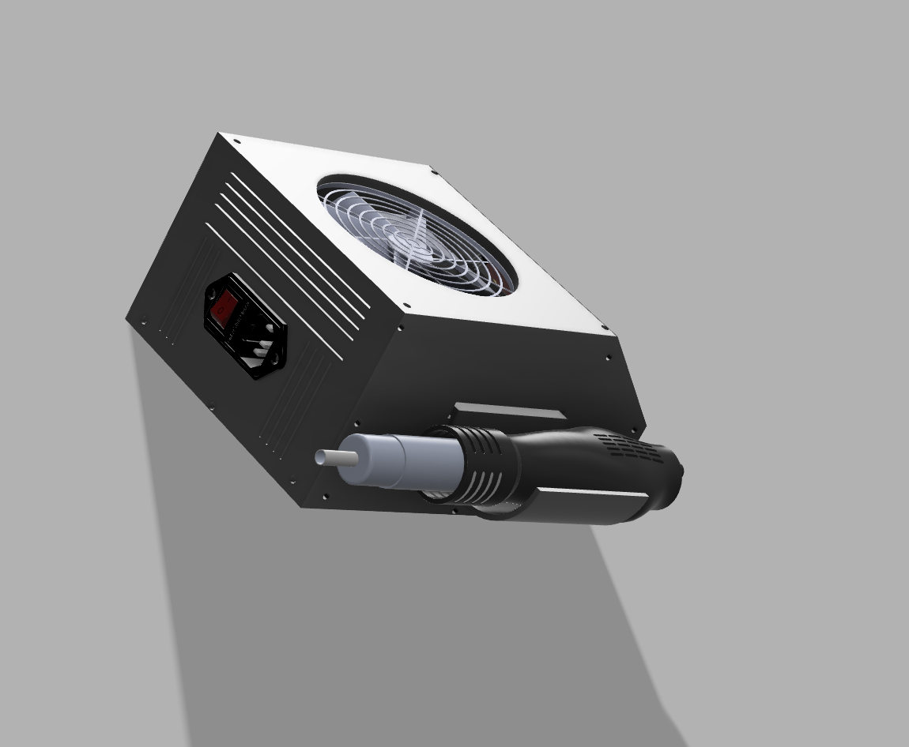
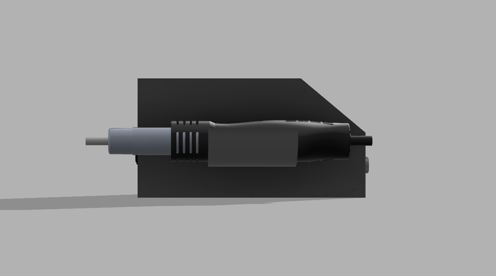

## 1. Project Overview
The **Chronos-858D** is a custom-engineered, smart benchtop hot air rework station built around the **ESP32-S3-DevKitC-1** that combines microcontroller precision with robust AC/DC power electronics. Designed from the ground up with a custom 2-layer KiCad PCB and a 3D-printed Fusion 360 enclosure, the station regulates a 220V AC 700W ceramic heating element using  PID control through a  optical isolation stage while independently driving a 24V DC brushless blower fan via PWM. For workshop safety  a physical roller-lever microswitch mounted on the handle cradle automatically detects when the hot air gun is docked, immediately cutting power to the heater coil and running a timed 1-minute cooling cycle until the nozzle drops safely below 50°C, with all real-time temperature measuring, airflow power, and with the stats on a 2.8-inch ILI9341 SPI TFT display controlled by 2 rotary encoders.

---

## 2. Final CAD Renders & Enclosure Design
The enclosure and external handle holder are fully modeled in Fusion 360  for 3D printing in heat-resistant PETG or ABS, and also have an angled front instrument panel and ventilated case that house both the custom main PCB and the 24V 3A industrial SMPS in a compact case. To add tight 3mm thread depths and 3.2mm mounting holes on the display and main circuit board, the internal standoffs are designed around M3 × 3mm knurled brass heat-set inserts paired with M3 × 4mm pan head machine screws, while the side-mounted integrates a recessed slot for a KW11-3Z roller limit switch positioned along the cool lower grip of the 858D handle so the resting weight of the wand actuates the cooldown switch smoothly without exposing the switch body to nozzle heat.

---

## 3. ⚠️ High-Voltage Safety Warning
> **DANGER — 220V–240V AC MAINS VOLTAGE:** This rework station interfaces directly with lethal 220V–240V AC mains electricity to power the 700W heating element and internal SMPS, which presents a severe risk of electrocution, burns, or fire if handled improperly. Always disconnect the main AC power cord from the wall outlet before opening the enclosure, probing the circuit board, or modifying any wiring, and strictly maintain the 2.5mm physical creepage and clearance gap on the PCB between the high-voltage AC heater section and the low-voltage DC microcontroller logic. Ensure that the incoming protective earth ground pin on the IEC320 C14 socket is securely bonded to the metal frame of the 24V SMPS and the insulated-tab BTA16-600B TRIAC heatsink, and insulate all high-voltage solder joints and terminal connections using polyolefin heat shrink tubing and high-temperature polyimide Kapton tape before powering the system.

---

## 4. Electronic Specifications & Pinout
The electrical designing  separates high-voltage AC switching from low-voltage 3.3V digital control across a custom 2-layer  PCB powered by a 24V DC 3A (72W) enclosed SMPS protected by a 2A resettable PTC polyfuse . An onboard LM2596 buck converter  steps the 24V rail down to a regulated 5.0V DC to feed the ESP32-S3-DevKitC-1 , while the 24V blower fan is controllerd through an IRLZ44N logic-level N-channel MOSFET , paired with a 10kΩ gate pull-down resistor , 220Ω gate resistor , and 1N4007 flyback clamping diode . 

On the isolated AC side  protected by a 5A 250V fast-blow glass fuse , HEATER_PWM  drives an MOC3041 zero-crossing optocoupler  through a 150Ω current-limiting resistor , which triggers a 16A 600V BTA16-600B TRIAC  via a 360Ω 1W gate resistor  and a 39Ω 2W / 0.01µF 275VAC X2 RC snubber network . Closed-loop temperature feedback from the handle's K-type thermocouple  is digitized by a MAX6675 cold-junction compensated amplifier  sharing the hardware SPI bus with the non-touch 9-pin 2.8" ILI9341 240×320 TFT display (`J3`), alongside two EC11 rotary encoders  and the holder  limit switch.

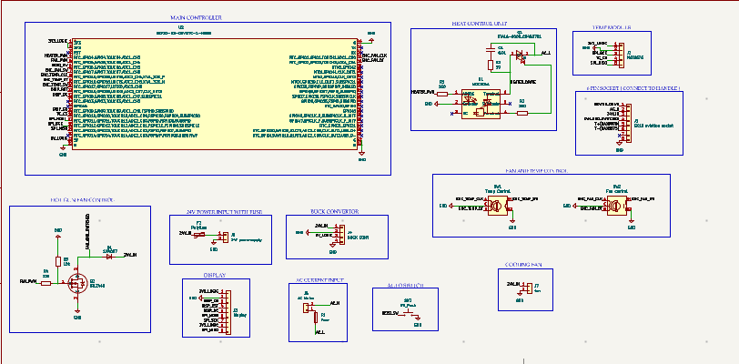
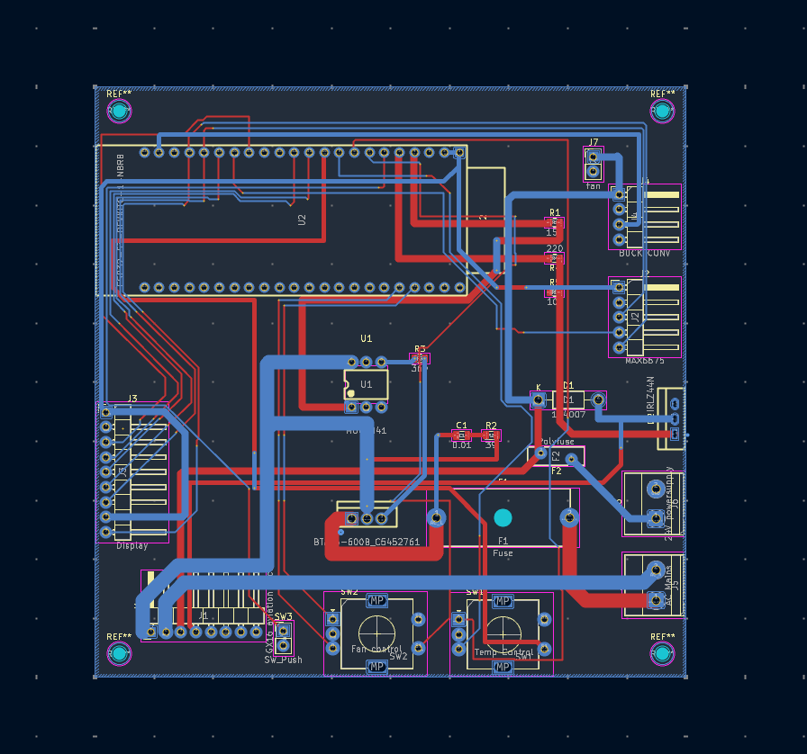
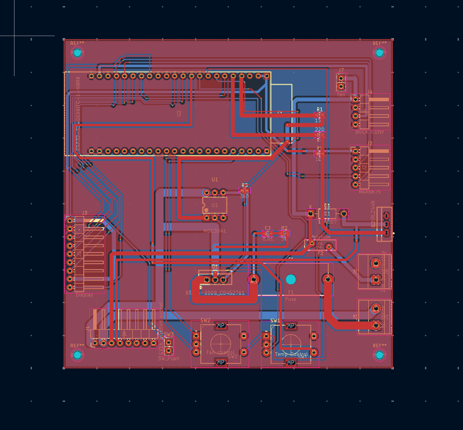
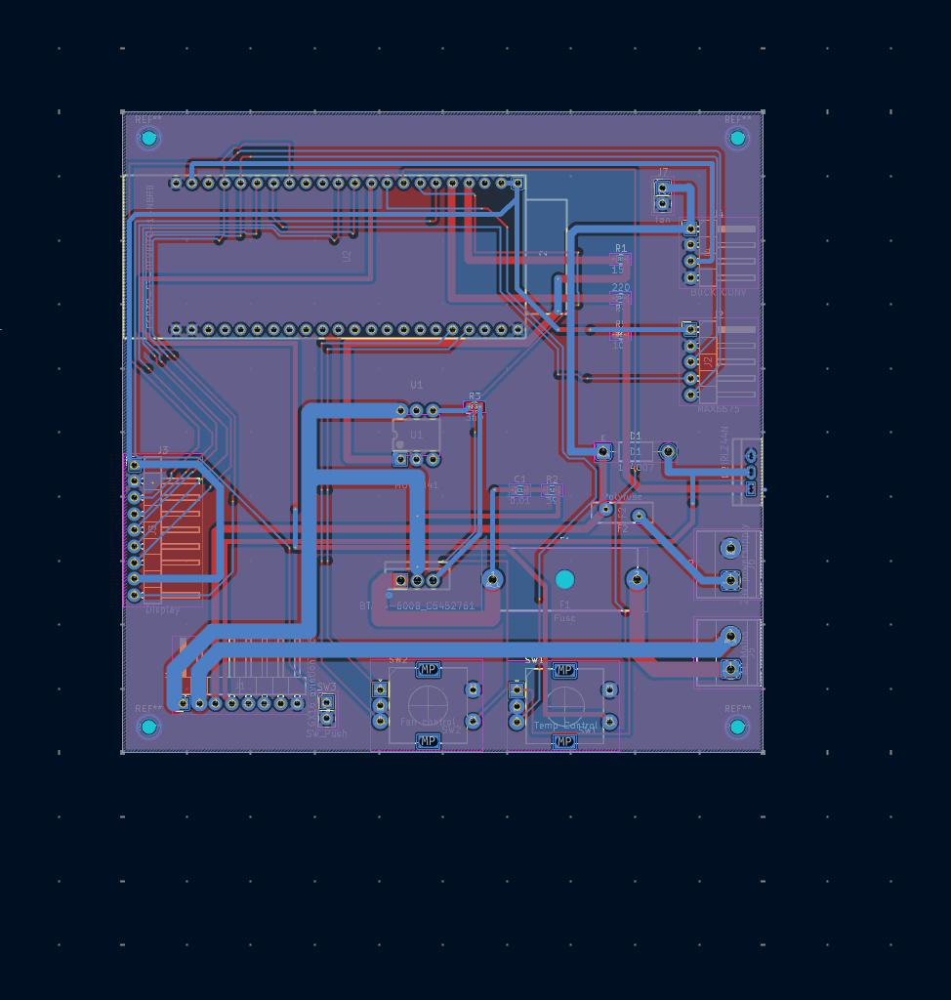
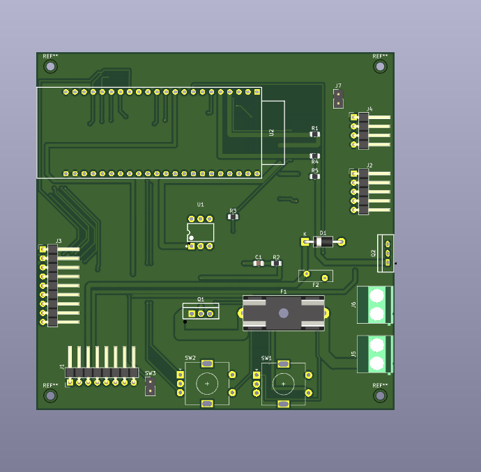

## 5. Enclosure & Case Assembly
pressing the M3 × 3mm brass heat-set inserts flush into the 3D-printed mounting bosses inside the front bezel and main chassis floor, then pre-tune the LM2596 buck converter  with a multimeter to output exactly 5.0V DC before seating the ESP32-S3 into its female headers. Next, mount the 2.8-inch ILI9341 TFT display and the populated main PCB onto the internal standoffs using M3 × 4mm pan head screws, fasten the two EC11 rotary encoders and the GX16-8 aviation panel socket to the front face, and bolt the TO-220 aluminum heatsink onto the BTA16-600B TRIAC  with a thin layer of thermal paste. Secure the 24V 3A SMPS to the base of the enclosure double-sided heavy-duty foam tape, snap the IEC320 C14 AC mains inlet switch into the rear panel cutout, and fasten the KW11-3Z roller limit switch onto the external handle cradle using M2 screws and nuts. Finally, wire the 16 AWG silicone power cables from the IEC inlet and SMPS to the screw terminal blocks  and the 24 AWG signal wires from the cradle switch , insulating all exposed AC and DC joints with heat shrink tubing and Kapton tape before closing the case and verifying electrical isolation with a continuity test.

---

## 6. Firmware Architecture & Cooldown Logic
The ESP32-S3 firmware runs a non-blocking C++ control loop that continuously polls the MAX6675 sensor over hardware SPI every 250ms, feeds the nozzle temperature into a PID control algorithm to update the zero-crossing heater duty cycle on `GPIO 4` (`HEATER_PWM`), and refreshes the 2.8-inch ILI9341 TFT display while tracking rotary encoder interrupts for instant target temperature and fan speed adjustments. When the user places the hot air gun into the cradle, the weight of the handle depresses the KW11-3Z roller lever and pulls `GPIO 6` (`REED_SW`) to `GND` (`LOW`), which immediately forces the heater output to `0%`, switches the UI to Cooldown Mode, and locks the 24V blower fan (`GPIO 5`) at 80%–100% speed for a full 1-minute cooldown timer (and until the thermocouple reading drops below 50°C) before shutting the fan off completely and entering low-power

### **Chronos-858D Master Bill of Materials (BOM)**
| # | Component | Supplier | Qty | Total (INR) | Total (USD) | Product Link |
| :--- | :--- | :--- | :---: | :---: | :---: | :--- |
| **1** | Custom 3D-Printed Enclosure + Cradle | PrintLegion | 1 | ₹2,500 | $26.88 | [Link](https://printinglegion.hackclub.com) |
| **2** | Custom 2-Layer PCB Manufacturing | Robu | 1 | ₹900 | $9.68 | [Link](https://robu.in/) |
| **3** | ESP32-S3-DevKitC-1-N8R8 | Robu | 1 | ₹1,839 | $19.77 | [Link](https://robu.in/product/espressif-esp32-s3-devkitc-1-n8r8-development-board/) |
| **4** | 2.4" SPI TFT Touch Screen Module | MakerBazar | 1 | ₹679 | $7.30 | [Link](https://makerbazar.in/products/2-4-inch-spi-interface-240-320-tft-display-module?variant=44937178022128) |
| **5** | MAX6675 Thermocouple Module | MakerBazar | 1 | ₹309 | $3.32 | [Link](https://makerbazar.in/products/max6675-thermocouple-sensor-module) |
| **6** | LM2596 DC-DC Buck Step-Down Module | MakerBazar | 1 | ₹79 | $0.85 | [Link](https://makerbazar.in/products/lm2596-dc-dc-converter-step-down-module?variant=48251191918832) |
| **7** | Quick 858D Replacement Handle (8-wire) | TonyVision | 1 | ₹649 | $6.98 | [Link](https://www.tonyvision.in/product/30533442/Quick-858-Handle-For-858-SMD-Rework-Station--8-Wire-) |
| **8** | GX16-8 Aviation Socket (Panel Mount) | Probots | 1 | ₹160 | $1.72 | [Link](https://probots.co.in/8-pin-gx16-male-to-female-aviation-plug.html) |
| **9** | 24V 3A Metal Enclosed SMPS | ElecComp | 1 | ₹500 | $5.38 | [Link](https://www.electronicscomp.com/24v-3amp-smps-dc-metal-power-supply-nwp-india) |
| **10** | KW11-3Z Roller Lever Micro Switch | MakerBazar | 1 | ₹20 | $0.22 | [Link](https://makerbazar.in/products/automation-direct-limit-switch?variant=46931163742448) |
| **11** | IEC320 C14 AC Mains Socket + Rocker | Probots | 1 | ₹210 | $2.26 | [Link](https://probots.co.in/3-pin-iec320-c14-ac-power-socket-with-fuse-red-rocker-switch-panel-mount-connector.html) |
| **12** | Finned Aluminum Heatsink Kit | MakerBazar | 3 | ₹87 | $0.94 | [Link](https://makerbazar.in/products/3pcs-aluminum-heatsink-with-thermal-tape-for-raspberry-pi-4-model-b-black?variant=48460430213360) |
| **13** | KF301 2-Pin 5.08mm Screw Terminal | Robu | 2 | ₹20 | $0.22 | [Link](https://robu.in/product/kf301-2-pin-5-08mm-pitch-plug-in-screw-terminal-block-connector-pack-of-5/) |
| **14** | 240V AC Power Cord 3-Pin to IEC C-13 | MakerBazar | 1 | ₹159 | $1.71 | [Link](https://makerbazar.in/products/240v-ac-power-cord-3-pin-to-iec-c-13-female-cable?variant=44609024262384) |
| **15** | 20AWG Flexible Silicone Wire (Green) | Robu | 1 | ₹50 | $0.54 | [Link](https://robu.in/product/high-quality-ultra-flexible-20awg-silicone-wire-1000m-green/) |
| **16** | BTA16-600B TRIAC (Pack of 5) | Amazon | 1 | ₹169 | $1.82 | [Link](https://www.amazon.in/pics-BTA16-600B-TRIAC-Volts/dp/B0C9VVTZTV/) |
| **17** | MOC3041M Zero-Cross Optoisolator | Robu | 1 | ₹50 | $0.54 | [Link](https://robu.in/product/moc3041m-ic-zero-cross-optoisolator-triac-driver-ic/) |
| **18** | IRLZ44N Logic-Level N-Channel MOSFET | Robu | 1 | ₹44 | $0.47 | [Link](https://robu.in/product/irlz44n/) |
| **19** | 1N4007 1W Rectifier Diode | Robu | 5 | ₹15 | $0.16 | [Link](https://robu.in/product/1n4007-1w-diode-pack-of-30/) |
| **20** | Hongyan EC11 Rotary Encoders | Robu | 2 | ₹116 | $1.25 | [Link](https://robu.in/product/hongyan-ec11h-7ce20p1zy20-rotary-encoder-with-push-button-switch-vertical-plug-in-5-pin/) |
| **21** | Loose M3 Screws, Nuts & 1m Heat Shrink | Local | 1 | ₹50 | $0.54 | *Local Hardware Store* |
| **22** | 330Ω 1/4W 1206 SMD Resistor | Robu | 1 | ₹15 | $0.16 | [Link](https://robu.in/product/330-ohm-1-4w-1206-surface-mount-chip-resistor-pack-of-100/) |
| **23** | 360Ω 0805 SMD Resistor (Yageo) | Robu | 1 | ₹15 | $0.16 | [Link](https://robu.in/product/rc0805fr-07360rl-yageo-360-ohms-%c2%b11-0-125w-1-8w-chip-resistor-0805-2012-metric-moisture-resistant-thick-film/) |
| **24** | 100Ω 1/4W 1206 SMD Resistor | Robu | 1 | ₹15 | $0.16 | [Link](https://robu.in/product/100-ohm-chip-resistor-1-4w-1206-surface-mount-pack-of-100/) |
| **25** | 10kΩ 0805 SMD Resistor | Amazon | 1 | ₹99 | $1.06 | [Link](https://www.amazon.in/Electronic-Spices-Power-Thick-Resistor/dp/B0BFD96R76/) |
| **26** | 100Ω 2W Carbon Film Resistor | Robu | 1 | ₹2.45 | $0.03 | [Link](https://robu.in/product/100-ohms-2w-carbon-film-resistor-pack-of-50/) |
| **27** | 100nF 400V DIP Polyester Film Cap | Robu | 1 | ₹6.00 | $0.06 | [Link](https://robu.in/product/100nf-400v-dip-polyester-film-capacitor-pitch10mm/) |
| **28** | 100nF 0805 SMD Ceramic Capacitor | Robu | 3 | ₹2.37 | $0.03 | [Link](https://robu.in/product/100nf-0805-surface-mount-multilayer-ceramic-capacitor-pack-of-40/) |
| **29** | 100µF 35V SMD Tantalum Capacitor | Robu | 1 | ₹57.00 | $0.61 | [Link](https://robu.in/product/100uf-35v-10-d-case-chip-tantalum-capacitorsmd-avx/) |
| | **FINAL GRAND TOTAL** | | | **₹8,816.82** | **$94.80** | |